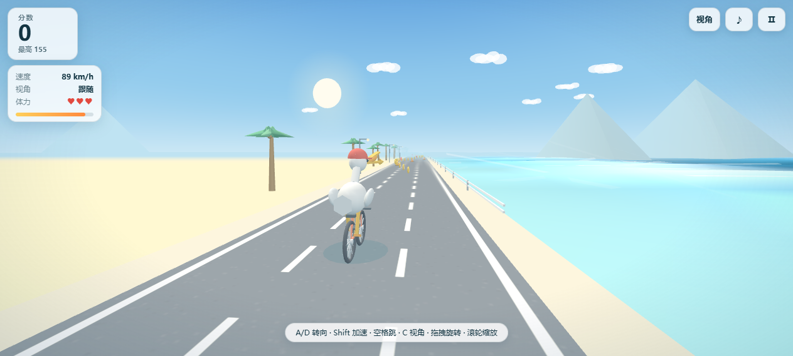
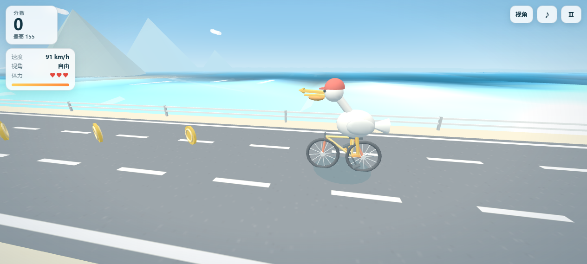
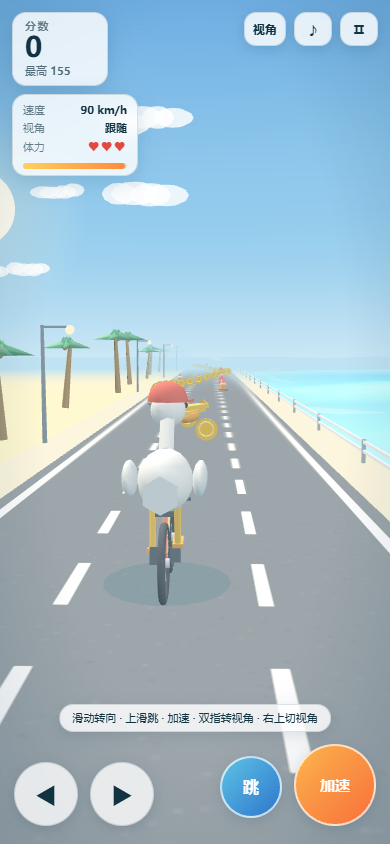

# 鹈鹕沿海骑行 · Pelican Coast Ride

一只鹈鹕骑着自行车，在沿海公路上自动前进的 3D 网页小游戏。PC / 手机浏览器打开即玩，无需下载、无需联网、无需构建。

**在线试玩：** https://skygx.github.io/bike/



## 玩法

| 项目 | 规则 |
| --- | --- |
| 前进 | 自动前进，速度随距离缓慢提升 |
| 金币 | +10 分；加速状态 +20 分 |
| 加速 | 按住消耗能量，能量自动回复；加速时撞上锥筒会**直接撞碎**，+30 分且不扣血 |
| 跳跃 | 跳过一定高度可**越过**锥筒 |
| 血瓶 | 捡到回 1 格血（上限 3 格）；满血时改为 +25 分 |
| 碰撞 | 未加速、未跳过时撞锥筒掉 1 格血并减速，3 格耗尽结算 |
| 最高分 | 保存在浏览器 `localStorage`，不上传 |

## 操作

| 操作 | PC | 手机 |
| --- | --- | --- |
| 左右移动 | `A` / `D` 或 `←` / `→` | 底部 ◀ ▶ 按钮，或左右滑动屏幕 |
| 加速 | 按住 `Shift` | 按住「加速」按钮 |
| 跳跃 | `空格` | 「跳」按钮，或上滑 |
| 切换预设视角 | `C` / `V`（跟随 → 侧面 → 俯视 → 骑手） | 右上「视角」按钮 |
| 自由旋转视角 | **鼠标拖拽** | 双指拖拽 |
| 拉近 / 拉远 | **鼠标滚轮** | 双指捏合 |
| 暂停 / 继续 | `P` / `Esc` | 右上 Ⅱ 按钮 |
| 重开 | `R`，结算时 `Enter` | 结算界面按钮 |

切到预设视角时自由相机会复位；再次拖拽即可重新自由观察。

## 画面

- 程序化低多边形建模：鹈鹕、自行车、棕榈、护栏、锥筒、金币、血瓶，零美术资源。
- 海面为每帧顶点波动的网格：波峰高光、近岸青绿色渐变、岸边碎浪与远海浪脊、沿太阳方向的金色波光带。
- 音效由 WebAudio 实时合成，可静音；没有音频文件。





## 本地运行

直接双击 `play.html` 即可（单文件，已内联 three.js，`file://` 协议可用）。

或启动任意静态服务器访问 `index.html`：

```bash
python -m http.server 8000
# 打开 http://localhost:8000/
```

## 文件

| 文件 | 说明 |
| --- | --- |
| `index.html` | 页面骨架、HUD、样式（源码版入口） |
| `game.js` | 全部游戏逻辑与 3D 场景 |
| `vendor/three.min.js` | three.js r128 UMD，本地离线依赖 |
| `play.html` | 由以上三者内联生成的单文件离线版 |
| `screenshots/` | 效果截图 |
| `LICENSE` | MIT |

开发时修改 `index.html` / `game.js` 后需重新生成 `play.html`（把两个 `<script src>` 替换为内联内容）。

## 技术

原生 JavaScript + three.js r128。无框架、无打包、无网络请求、无后端。

## 许可证

[MIT](LICENSE) © 2026 skygx

第三方依赖 three.js r128 采用 MIT 协议，版权归 three.js 作者所有。
